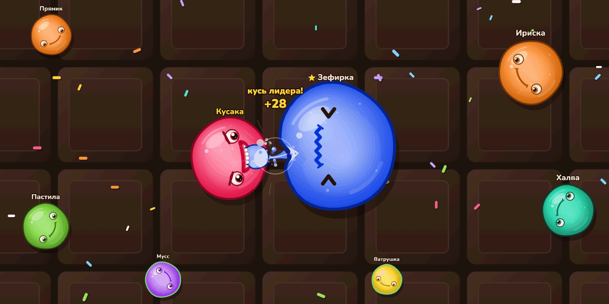
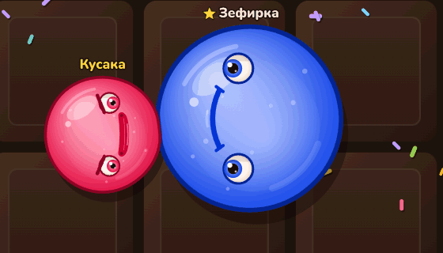
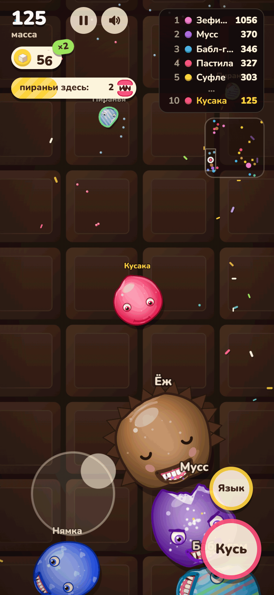
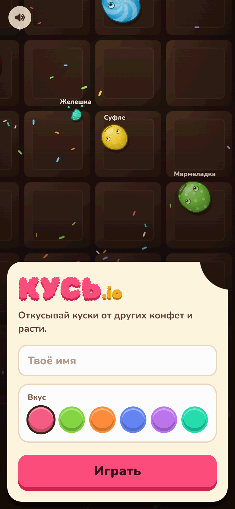
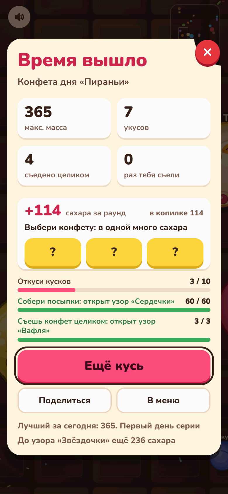
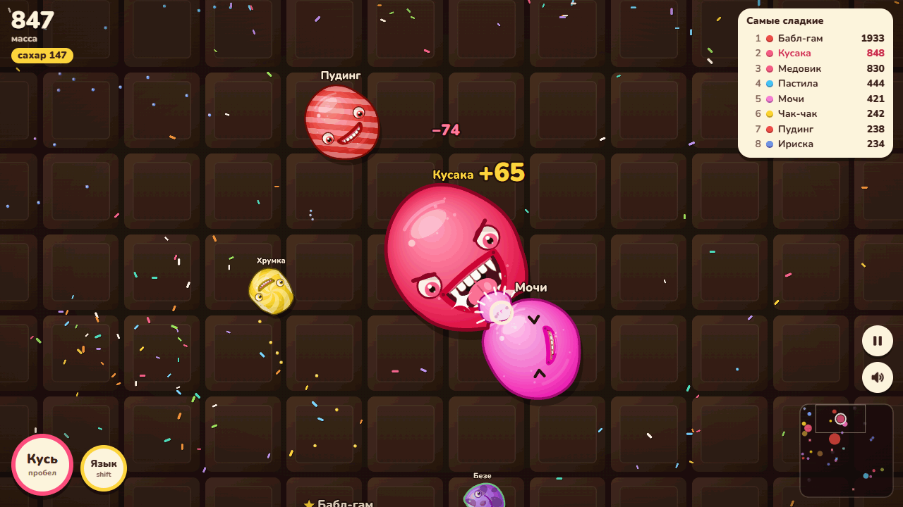
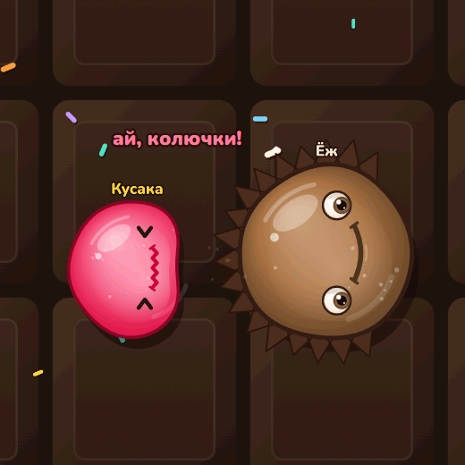
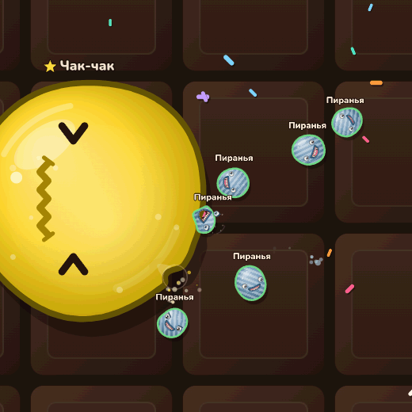
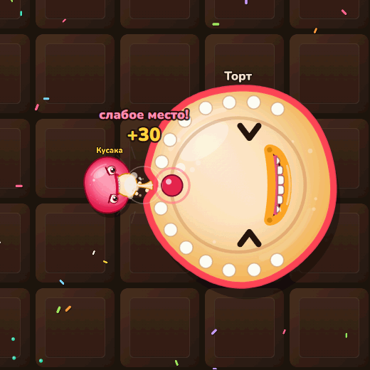

# КУСЬ.io

A browser game in the spirit of agar.io where soft candies bite pieces off each other instead of swallowing each other whole. «Кусь» is the Russian sound of a bite.



### [Play in the browser](https://antropos17.github.io/kus-io/)

Works on a PC and on a phone, nothing to install. The game's interface is in Russian.

## What kind of game it is

You are a soft candy on a chocolate tray with bot candies of every size. Your mouth is the only part that bites, so the best way in is from behind. A bite does not swallow the other candy: it tears off a piece, the piece stretches on a sticky strand between your teeth, you chew it, and its mass becomes yours.

The bitten candy stays in the game. It is left with a wound that heals over time. A fresh wound slows it down and sheds crumbs, and a bite into a fresh wound tears off a third more. A candy small enough that one bite would finish it is swallowed whole.

On the tray there are sprinkles to eat and bonuses: speed, a shield and a magnet. A sticky tongue pulls prey to your mouth.

Bites that follow one another build a streak (the window is 4 seconds; bites, swallows whole and bonus pickups count). While it lasts, «×N» jumps above your candy instead of its name, a fuse ring on the tray and one around the «Кусь» button burn down and blink at the end, and every bite sends sugar cubes flying into the sugar pill, which rolls its number like an odometer. Longer streaks bring stamps («Кусь-кусь!» at ×2, «Ням!», «Хрум-хрум!», «Обжора!», «На волоске!» for a bite at the last moment), bigger eyes and, from ×5, a sugar rush of pulsing screen edges and sprinkles. When the streak ends a small pill says how much sugar it brought.

If a ×5 or longer streak runs out on its own in a run without cheats, a runaway wrapper, «Фантик», jumps out of the last wound and flees for 5 seconds with «Лови!» over it. Touch it with your candy to catch it: it unwraps in front of you (the game does not stop) and pays sugar, sometimes with a rarer reveal («Редкий!», «Джекпот!»). Bots ignore it. Measurements: [docs/stages.md](docs/stages.md).

<p align="center"></p>

## Screenshots

<p align="center">
  
  
  
</p>
<p align="center"><sub>Phone: playing, the first-visit menu, the end of a candy-of-the-day run</sub></p>



Special rivals:

<p align="center">
  
  
  
</p>

- The hedgehog has spines on its back: a bite from behind pricks you, bite it in the face.
- Piranhas come in packs and go for big candies.
- The cake is huge and does not hunt. Its crust is thick, the cherry on its back is the soft spot. In free play it comes only as the Big Cake boss.

## Controls

**PC**

- Mouse: where the mouth looks.
- Space or left click: a dash with a stronger bite, «Кусь» (bite).
- Shift or right click: the sticky tongue, «Язык» (tongue), pulls prey to the mouth.
- Esc or P: pause. M: sound on and off.

**Phone**

- Move a finger anywhere on the screen: a joystick appears under it.
- «Кусь» (bite): the dash with a stronger bite, can be held.
- «Язык» (tongue): the sticky tongue.
- The buttons sit on the left by default and the joystick hint on the right; in the settings and the pause menu they can go on the right instead, in three sizes.

## Modes

- «Свободная игра» (free play): no time limit, and the run has stages. A line under your mass shows the next event and how much mass is left to it. At mass 150 (or by 0:45 at the latest) a piranha pack comes for you; at 600 (or by 2:00) a sweet rain of sprinkles and bonuses falls around you for 15 seconds; at 1600 the Big Cake, «Большой Торт», comes after you. It is a boss only you can bite: its crust is hard, it keeps its mouth turned to you and bites, then turns away for a few seconds, and that is the moment for the cherry on its back. A cherry bite makes it whirl round; at two thirds and one third it calls a piranha escort. Eat it and the run ends with a trophy card, «Торт съеден!» (the cake is eaten): the clear time, a new-record ribbon, tiles for mass, bites and sugar, and a live frosting frame around the card that is poured on as it appears. Your best time is kept. «Вторая смена» (second shift) carries on with the same mass and place and a fresh score: the events come round by timers, faster, and each lap's cake is tougher. In free play there is no other cake and no other piranha packs. Design and measurements: [docs/stages.md](docs/stages.md).
- «3 минуты на счёт» (3 minutes for score): a timed run, the best result is kept.
- «Конфета дня» (candy of the day): a three-minute run on normal difficulty with a twist that comes from the date and is the same for everyone that day, such as twice as many hedgehogs, piranha packs from the first seconds or a cake on the tray from the start. The game keeps your best of the day and how many days in a row you have played. After a run you can send a friend a challenge link with your score; a link from an earlier day says that candy is over.

There are three difficulties: «Лёгкая» (easy), «Обычная» (normal) and «Жёсткая» (hard).

Between runs:

- Sugar is earned for bites and for eating in a run without cheats. At the end of a run you pick one of three candies with a sugar bonus inside.
- Sugar buys hats, patterns, eyes, a trail behind your candy and the tray you play on, in the menu. Everything is earned by playing; the whole wardrobe is meant to last about 30 hours of play (the prices are not measured against that yet).
- Missions pay sugar, more with every round of missions.
- After you pick a chest candy you can pay sugar to shuffle and pick once more.
- The album: swallow a candy whole and its sticker is yours. Thirty named candies in six rows, some much rarer than others; a full row pays sugar once.
- The first visit gets a short menu (name, flavour, «Играть», play), and the first run starts with an easy snack in front of you.

## Under the hood

- The whole game is one HTML file with no external scripts (only web fonts are loaded). It is built from the sources in `src/` and can be opened straight from disk.
- Canvas 2D and plain JavaScript: no libraries, no framework, no server. All rivals are bots that run in the page.
- Soft bodies: every candy is a ring of points that springs back to its shape, dents on contact and wobbles like jelly.
- Sound: most effects are short recorded takes made with [earshot](https://github.com/Leonxlnx/earshot) and embedded in the page as data, so there are still no separate audio files. The stretchy strand, and any take that fails to decode, is synthesized with the Web Audio API.
- The graphics tune themselves: when frames start to drop, the game lowers the detail and then the resolution, and raises them again when there is room.
- Movement does not depend on the frame rate, and the system "reduce motion" setting turns off flashes and camera kicks.

## Development

You need Node.js and an installed Chrome.

```
npm install
npm run build   # build index.html from src/
npm test        # build, then run the tests in headless Chrome
npm run check   # fail if index.html does not match src/
npm run og      # rebuild og.png, the link preview picture
npm run shots   # rebuild the screenshots in docs/media/
npm run sfx     # re-embed the sound takes listed in tools/sfx.json (needs ffmpeg and the earshot takes on disk)
```

`index.html` in the root is generated from `src/` and committed together with the sources, because GitHub Pages serves it. Edit `src/`, then run `npm run build`.

`npm test` runs 42 tests through `playwright-core`: startup on PC and phone, the phone buttons staying inside the screen, the bite rules, the first-visit menu, sugar and the shop, the candy of the day and its challenge links, the stages and the trophy card, the streak, the runaway wrapper and the cream-pill HUD, the bots, settings, every sound effect, and three simulated minutes of the autopilot on ragged frames. The tests do not see the picture or hear the sound, and the game has not been tested automatically on a real iPhone.

How the code is organised is described in [`CLAUDE.md`](CLAUDE.md).

## Not there yet

- Multiplayer. All rivals are bots; playing against people would need a server.
- A Telegram Mini App.

## License

[MIT](LICENSE). The code, the art drawn by it and the screenshots are free to use, change and share.
